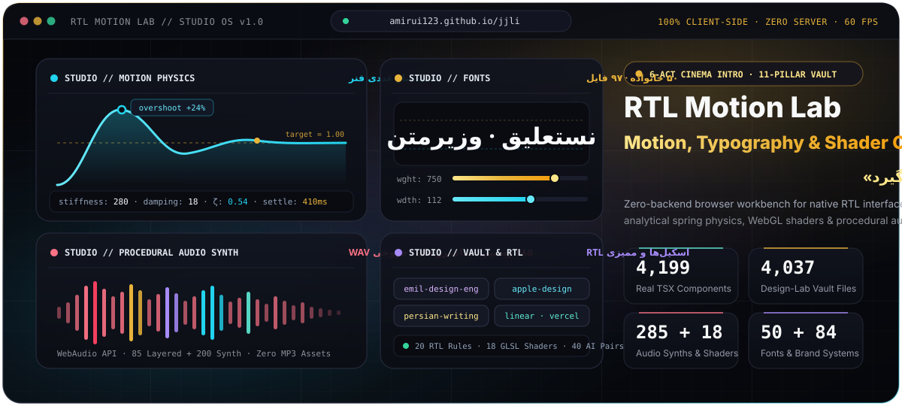
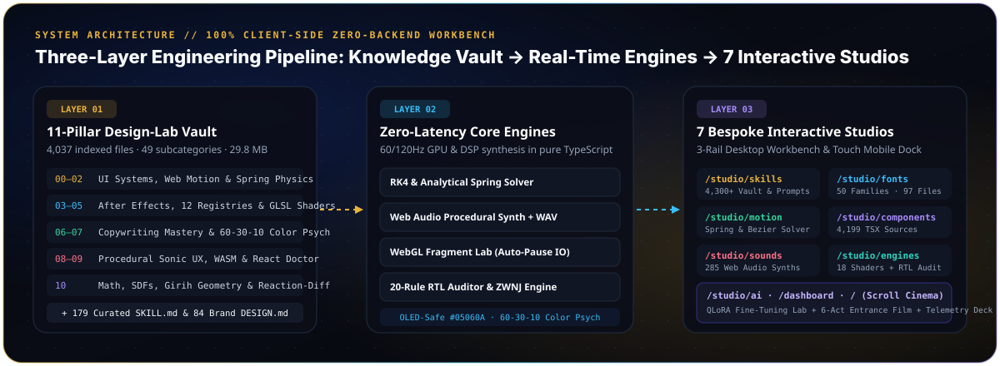

<div align="center">

<a href="https://amirui123.github.io/jjli/">
  
</a>

<br />

# RTL Motion Lab

### _"Motion is the native language of the interface."_

A **100% free, open-source, zero-backend browser workbench** for designing and engineering world-class Right-to-Left (RTL) interfaces:<br />
**4,049** Design-Lab Vault Files (`11` Pillars) · **93** Persian, Arabic &amp; English Font Families · **4,199** Component Sources · **285** Synthesized Sounds · **179** Engineering Skill Docs · **84** Brand Design Systems · **26** Live WebGL Shaders (with 64-Cell Persian Glyph Atlas)

<p>
  <a href="https://amirui123.github.io/jjli/">
    
  </a>
  <a href="https://github.com/amirui123/jjli/actions/workflows/pages.yml">
    
  </a>
  
  
</p>

</div>

---

## ⚡ See It Live Right Now

The entire workbench opens instantly in your browser directly from GitHub Pages—**no sign-up, no backend server, and no API keys required**:

> ### 🌐 **[https://amirui123.github.io/jjli/](https://amirui123.github.io/jjli/)**
>
> **One URL, one complete engineering OS** — responsive across desktop and mobile, natively Right-to-Left, and offline-capable.

To run the full platform locally on your machine:

```bash
npm ci
npm run dev      # Starts the local development server on port 5173
```

---

## 🛠️ The Studios — A Seven-Workbench Suite

Every studio is a self-contained, **zero-page-scroll desktop workbench** built around a 3-rail architecture (`Settings & Export / Live Center Stage / Virtualized Catalog`) that automatically transforms into a **3-Tab Touch Sheet** on mobile devices:

<table>
  <tr>
    <td width="33%" valign="top">
      <h3>🟡 Font Studio</h3>
      <p><strong>93 Persian, Arabic &amp; English font families</strong> (Nastaliq, calligraphic, display, variable, editorial, coding ligature monospace, and English display) with 8 live typographic axes, direct <code>woff2/woff/ttf</code> downloads, and copy-ready outputs for CSS <code>@font-face</code>, Tailwind v4, and <code>next/font</code>.</p>
      <p><code>#/studio/fonts</code></p>
    </td>
    <td width="33%" valign="top">
      <h3>🔵 Motion Studio</h3>
      <p><strong>Numerical spring-physics ODE solver</strong> and cubic-bezier lab; computes exact settling time (<code>ms</code>), damping ratio (<code>ζ</code>), and peak overshoot percentage with instant code generation for Framer Motion, CSS <code>linear()</code>, and GSAP.</p>
      <p><code>#/studio/motion</code></p>
    </td>
    <td width="33%" valign="top">
      <h3>🟢 Component Studio</h3>
      <p><strong>4,199 real component sources</strong> (<code>4,888</code> total files across 12 open-source registries) with a virtualized explorer, interactive Bento stage, live source inspector, and one-click single-file <code>.tsx</code> or full <code>.zip</code> kit downloads.</p>
      <p><code>#/studio/components</code></p>
    </td>
  </tr>
  <tr>
    <td width="33%" valign="top">
      <h3>🔴 Sound Studio</h3>
      <p><strong>285 procedural sound recipes</strong> (<code>85</code> multi-layer DSL designs + <code>200</code> synth effects) powered by the Web Audio API; zero heavy MP3 network requests, real-time oscilloscope waveform rendering, and instant 16-bit PCM <code>.wav</code> export.</p>
      <p><code>#/studio/sounds</code></p>
    </td>
    <td width="33%" valign="top">
      <h3>🟣 Skills &amp; Vault Studio</h3>
      <p><strong>4,049 categorized Design-Lab vault files</strong> across <strong>11 Pillars &amp; 50 subcategories</strong>, plus <strong>179 curated skill docs (<code>SKILL.md</code>)</strong> and <strong>84 brand design systems (<code>DESIGN.md</code>)</strong> with a decluttered Pillar ribbon, full markdown/code reader, and an AI Prompt Compiler.</p>
      <p><code>#/studio/skills</code></p>
    </td>
    <td width="33%" valign="top">
      <h3>💠 Shader &amp; Engines Lab</h3>
      <p><strong>26 live GLSL fragment shaders</strong> (including 8 Hacker, Matrix Rain, 3D Cyber Hallway &amp; CRT shaders rendering real Persian letters via a 64-cell WebGL Glyph Atlas) paired with a <strong>20-rule automated RTL code auditor</strong> and Iranian validation engines.</p>
      <p><code>#/studio/engines</code></p>
    </td>
  </tr>
</table>

> **Additional Platform Routes:** Scroll-Choreographed Home (`#/`) · **Orbital Command &amp; Telemetry Dashboard** with real-time radial SVG gauges (`#/dashboard`) · **AI Fine-Tuning Studio** with 40 real instruction pairs, interactive pipeline visualizer, and QLoRA config generator (`#/studio/ai`). Jump across any route instantly via the TopBar, Bottom Dock, or `⌘K` Command Palette.

---

## 🎯 Why This Platform? (Before vs. After)

Grounded in the engineering review framework from [`emil-kowalski/emil-design-eng`](public/vault/skills/01-motion-and-awwwards__emil-kowalski__emil-design-eng.md), every architectural decision in RTL Motion Lab solves a concrete failure mode in modern RTL web development:

| Before (Common RTL Web Practice)                                             | After (Inside RTL Motion Lab)                                                                                                        | Why It Matters                                                                                                                                      |
| :--------------------------------------------------------------------------- | :----------------------------------------------------------------------------------------------------------------------------------- | :-------------------------------------------------------------------------------------------------------------------------------------------------- |
| **Picking fonts from static PNGs** without testing weight or variable axes   | **Live testing of 50 font families (`89` real font files)** on custom copy + production `@font-face` export                          | True legibility and visual voice only emerge when interacting with real size, line-height, and variable weight axes                                 |
| **Using `transition: all 300ms ease`** on every UI element                   | **Numerical differential-equation spring solver** (`stiffness / damping / mass`) with exact settling telemetry                       | Real-world objects never move at constant linear velocity; physical springs remain interruptible and redirectable mid-flight                        |
| **Forcing LTR templates into RTL** with manual `left` / `right` overrides    | **100% CSS Logical Properties (`ms/me/ps/pe/start/end`)** + automated 20-rule RTL static analysis &amp; auto-fix                     | Patchwork RTL breaks on edge cases; logical properties, ZWNJ (`نیم‌فاصله`), Persian numerals, and zero positive `letter-spacing` must be systematic |
| **Loading dozens of MP3 files** for button clicks and UI alerts              | **Real-time synthesis of 285 sound effects** in the browser via Web Audio API + on-the-fly `.wav` generation                         | Eliminates audio network requests, guarantees zero-latency tactile feedback, and unlocks live pitch/filter/envelope shaping                         |
| **Running heavy animations on high-frequency actions** &amp; burning the GPU | **Zero-animation instant Command Palette (`⌘K`)** + automatic off-screen pause (`IntersectionObserver`) &amp; GPU disposal for WebGL | Actions triggered dozens of times a day must never lag, and off-screen shaders must never drain laptop or phone batteries                           |

---

## 🧠 Design &amp; Engineering Methodology (Built From the Platform's Own Vault)

Both this application and this documentation were engineered directly from the skill blueprints and brand design systems stored inside the repository (`public/vault/` and `design-lab/`):

1. **The Philosophy of Invisible Details — [`emil-kowalski/emil-design-eng`](public/vault/skills/01-motion-and-awwwards__emil-kowalski__emil-design-eng.md)**

   > _"Taste is not innate—it is trained. Details users never consciously notice compound together to create the unmistakable feeling of craft."_
   - **Frequency Decision Matrix:** High-frequency keyboard shortcuts (`⌘K`, `F` for Focus Mode, `Esc`) open with zero decorative delay; interactive triggers respond on pointer-down with tactile `scale(0.97)` feedback.

2. **Fluid Physics &amp; Interruptibility — [`emil-kowalski/apple-design`](public/vault/skills/01-motion-and-awwwards__emil-kowalski__apple-design.md)**

   > _"Treat animation as a live conversation between the user's hand and the object—never as a pre-recorded movie."_
   - In Motion Studio, transitions are modeled via initial velocity, damping ratio (`ζ`), and frequency response so any motion can be caught and reversed mid-flight without snapping.

3. **Judging Standard &amp; Performance Budget — [`awwwards-engineering`](public/vault/skills/01-motion-and-awwwards__awwwards-engineering.md)**

   > _"You need one unforgettable signature moment—not twenty scattered effects—and performance accounts for 30% of the final score."_
   - **Signature Moment (`IntroSeal.tsx`):** A **gold seal that falls, strikes the sheet and is pulled off**, ~1.9s, skippable from the first beat with `رد کردن` or `Esc` — the signet prints the site's own «م» inside an eight-fold girih, the strike throws two pressure fronts and a shock of light, and the mark it leaves then opens the page itself while the hero performs its entrance underneath. One continuous motion, not a preloader followed by a page.
   - **Dedicated Mobile Architecture:** Instead of squeezing a 3-column desktop screen onto a phone, every studio adapts into a 3-tab mobile workspace (`Preview / Settings / Catalog`) with `≥ 40px` touch targets, `16px` inputs (preventing forced iOS zoom), and `safe-area-inset-bottom` padding.

4. **Kinetic Choreography &amp; Restraint — [`animation-systems`](public/vault/skills/03-art-direction-and-taste__mengto-web-design-systems__animation-systems.md)**
   - Inspired by **Stripe × Linear × Apple × Vercel**: primary anchors lead the motion, secondary elements follow with tight stagger intervals to guide reading order, and scroll-driven sections (`Landing.tsx`) combine top-dropping badges, opposite horizontal kinetic ribbons, and piece-by-piece chapter reveals.

5. **Conversion Copywriting &amp; Native RTL Mechanics — [`persian-writing`](public/vault/skills/06-persian-writing-and-rtl.md) &amp; [`copywriting-mastery`](design-lab/06-COPYWRITING-TRUST-AND-ANTI-CLICHE/readme-copywriting-mastery/copywriting-mastery-SKILL.md)**
   - **Clarity over cleverness &amp; specificity over vagueness:** zero robotic filler, strict adherence to Persian ZWNJ (`نیم‌فاصله`), localized numerals, guillemet quotation marks (`«»`), and value-first technical documentation.

6. **60-30-10 Color Psychology, Hairline Borders &amp; Editorial Typography — [`linear.app`](public/vault/brands/linear.app.md) · [`vercel`](public/vault/brands/vercel.md) · [`claude`](public/vault/brands/claude.md)**
   - **60% Dominant Void (`#05060A` OLED Pre-Charged Obsidian)** to prevent OLED black smearing on scroll; **30% Atmospheric Structure** using reactive color-psychology wallpapers (`nebula-lapis-gold.jpg`, `emerald-turquoise-aurora.jpg`, `amethyst-horizon-silk.jpg`) and `1px` hairline borders; **10% Catalytic Focal Accent** (`#E8B33A` Saffron Gold, `#2DD4BF` Turquoise, `#A78BFA` Violet).

---

## 🔬 Technical Details, Measured Inventory &amp; Infrastructure

<div align="center">
  
</div>

### 📊 1. Measured Asset Inventory (Verified via Automated Scripts)

Not a single counter in the UI or in this document is hand-typed decoration; every metric is automatically indexed and verified against disk in `src/data/toolkitStats.ts` and `src/data/designLabManifest.ts`:

| Asset / Platform Module                   | Exact Measured Count         | Technical Implementation Details                                                                                                                                                                                                                        |
| :---------------------------------------- | :--------------------------- | :------------------------------------------------------------------------------------------------------------------------------------------------------------------------------------------------------------------------------------------------------ |
| **11-Pillar Design-Lab Vault**            | **4,049 Files (`29.91 MB`)** | Organized across **11 Pillars** (`00` to `10`) and **50 subcategories** in `/design-lab/`, self-indexed in `src/data/designLabManifest.ts`                                                                                                              |
| **Persian, Arabic &amp; English Fonts**   | **93 Families**              | **132 physical font files** (`woff2` / `woff` / `ttf`) mapped across `src/data/fontFiles.ts` with `font-display: swap` and coding ligatures                                                                                                             |
| **Component Source Code**                 | **4,199 Component Sources**  | **4,888 total files** (including `4,068` `.tsx` files) partitioned into lazy-loaded JSON chunks inside `public/regcode/chunks/`                                                                                                                         |
| **Open-Source Registries**                | **12 Registries**            | Smooth UI (`1,175`) · Effect UI (`1,081`) · Persian Blocks (`1,030`) · Animate UI (`540`) · Tailark (`243`) · React Bits (`218`) · Fancy (`149`) · Cult UI (`141`) · Kokonut UI (`102`) · Eldora UI (`97`) · Magic UI (`79`) · Motion Primitives (`33`) |
| **Curated Skill Blueprints (`SKILL.md`)** | **179 Documents**            | `21` Motion &amp; Awwwards · `39` 3D &amp; WebGL · `108` Art Direction &amp; Taste · `10` UI Systems · `1` Comprehensive Persian &amp; RTL Spec                                                                                                         |
| **Brand Design Systems (`DESIGN.md`)**    | **84 Brand Systems**         | Includes Linear, Vercel, Claude, Apple, Stripe, Raycast, Framer, Figma, Supabase, Cursor, and 74 additional global engineering brands                                                                                                                   |
| **Procedural Sound Recipes**              | **285 Audio Recipes**        | `85` multi-layer DSL sound designs (`soundLibrary.ts`) + `200` procedural synth effects (`soundsManifest.ts`) with 16-bit PCM `.wav` export                                                                                                             |
| **Live Graphics Shaders**                 | **26 GLSL Shaders**          | Includes 8 Persian-Glyph Hacker/Matrix/CRT shaders (`u_glyphTex` 8×8 Canvas Atlas), uniform sliders, `IntersectionObserver` pause, and full GPU disposal                                                                                                |
| **Native Iranian Engines**                | **18 Banks + 20 RTL Rules**  | BIN/Sheba (IBAN mod-97) detection, Luhn card validation, National ID checksum verification, number-to-Persian-words, and 20-rule RTL static auditor                                                                                                     |
| **AI Fine-Tuning Dataset**                | **40 Instruction Pairs**     | Real component-derived JSONL training pairs, system prompt compiler, interactive pipeline graph, and QLoRA config export in `public/ai/`                                                                                                                |

---

### 🏗️ 2. Code Architecture, Studio Workbench Frame &amp; Standalone Offline Build (`share/`)

#### Shared 3-Rail Studio Workbench (`src/ui/StudioShell.tsx`)

On desktop viewports (`≥ 960px`), every studio locks to `100dvh` with **zero outer window scroll**:

```text
┌────────────────────────┬──────────────────────────────────────┬────────────────────────┐
│   Customization Rail   │          Live Center Stage           │  Virtualized Catalog   │
│  (Independent Scroll)  │     (Always Centered in Viewport)    │   (Instant Filtering)  │
└────────────────────────┴──────────────────────────────────────┴────────────────────────┘
```

- **Resizable Splitters:** Vertical rail dividers can be dragged with the pointer or adjusted via keyboard arrow keys; double-clicking restores default proportions and persists widths in `localStorage`.
- **Instant Focus Mode (`F`):** Pressing `F` collapses both side rails so the Center Stage expands to full width; pressing `Esc` restores the 3-rail layout.

#### Repository Directory Tree

```text
jjli/
├── design-lab/                        # 11-Pillar Knowledge Vault (4,037 files · 49 subcategories · 29.84 MB)
│   ├── 00-INDEX-AND-BLUEPRINTS/       # Master taxonomy & cross-domain architectural maps
│   ├── 01-WEB-DESIGN-AND-UI-SKILLS/   # Swiss grids, spatial UI, design tokens & brand systems
│   ├── 02-WEB-MOTION-GRAPHICS-SKILLS/ # Spring physics, FLIP choreography & scroll timelines
│   ├── 03-AFTER-EFFECTS-LAB/          # Inertia expressions, ExtendScript & Lottie pipelines
│   ├── 04-UI-COMPONENT-REGISTRIES/    # Raw source trees across 12 open-source registries
│   ├── 05-SHADERS-WEBGL-AND-ENGINES/  # GLSL fragment shaders, SDFs & raymarching
│   ├── 06-COPYWRITING-TRUST-AND-ANTI-CLICHE/ # Conversion copywriting & README mastery
│   ├── 07-COLOR-AND-HUMAN-VISUAL-PSYCHOLOGY/ # 60-30-10 color psychology, OKLCH & OLED safety
│   ├── 08-UI-SOUND-DESIGN-AND-SONIC-UX/      # Procedural Web Audio synthesis & psychoacoustics
│   ├── 09-NEXT-GEN-WEB-LANGUAGES-AND-WASM-STACK/ # WASM, WebGPU & react-doctor static auditing
│   └── 10-MATH-PHYSICS-CHEMISTRY-AND-COMPUTATIONAL-GEOMETRY/ # Girih geometry & reaction-diffusion
├── docs/
│   ├── hero.svg                       # Custom SVG Hero telemetry banner
│   └── architecture.svg               # 3-Layer System Architecture SVG diagram
├── public/
│   ├── backgrounds/                   # 3 custom 60-30-10 color-psychology wallpapers (<230 KB each)
│   ├── fonts/                         # 89 physical Persian font files (.woff2 / .woff / .ttf)
│   ├── regcode/chunks/                # Lazy-loaded JSON chunks for 4,888 component files
│   ├── vault/skills/                  # 179 curated Markdown engineering skills
│   ├── vault/brands/                  # 84 brand design system analyses
│   └── ai/                            # 40 QLoRA instruction-tuning pairs & system prompts
├── src/
│   ├── App.tsx                        # Lazy route splitting, ErrorBoundary & MotionConfig
│   ├── components/IntroSeal.tsx       # «مُهر» entry sequence: fall → strike → lift → reveal
│   ├── components/ShaderSurface.tsx   # Lifecycle-managed WebGL canvas with GPU cleanup
│   ├── data/                          # Typed manifests (designLabManifest, skillsManifest, etc.)
│   ├── engines/                       # Web Audio synth, 18 GLSL shaders & 20-rule RTL auditor
│   ├── lib/                           # Hash router, persisted store, spring solver & ZIP writer
│   ├── pages/                         # Landing, Orbital Dashboard & 7 bespoke Studio pages
│   ├── shell/AppShell.tsx             # TopBar, Accessibility Calibration Menu, ⌘K & BottomDock
│   └── ui/StudioShell.tsx             # 3-rail desktop workbench & 3-tab mobile sheet
└── share/
    └── rtl-motion-lab-standalone.html # 100% offline single-file HTML bundle (file:// protocol ready)
```

#### CLI Commands

```bash
npm run dev          # Generate manifests + start Vite dev server on 0.0.0.0:5173
npm run build        # Generate manifests + build optimized production chunks in dist/
npm run lint         # Run ESLint (react-hooks + jsx-a11y) across src/ and scripts/
node scripts/smoke-test.mjs       # Build + run 10-route headless DOM, a11y & persistence smoke suite
node scripts/build-single-file.mjs # Build the standalone offline single-file HTML in share/
```

#### Standalone Single-File Offline Build (`share/rtl-motion-lab-standalone.html`)

Generated via `node scripts/build-single-file.mjs`, `share/rtl-motion-lab-standalone.html` (`~22.9 MB`) packages the **entire real application**—all JavaScript, CSS, Persian fonts, component sources, and vault documents compressed via `gzip` + `base64`—into a single HTML file with an in-memory `fetch` interceptor that runs directly over `file://` with zero internet connection.

---

### 🚀 3. GitHub Pages Deployment Infrastructure &amp; Automated Verification Suite

#### Automated CI/CD via GitHub Actions (`.github/workflows/pages.yml`)

- On every push to `main`, the GitHub Pages workflow builds the application with `VITE_BASE=/jjli/` and deploys it to **`https://amirui123.github.io/jjli/`**.
- During build, `dist/index.html` is duplicated to `dist/404.html` so any deep path or hash route boots the SPA cleanly without 404 errors.
- Every runtime asset loader (`loadAsset`, `loadText`, `saveUrl`, `publicUrl`) resolves paths through `src/lib/base.ts` so assets work identically under `/jjli/` on GitHub Pages and `/` on local dev or Vercel.
- **Smart Rollup Chunking &amp; Tailwind v4 Source Scoping (`vite.config.ts` &amp; `src/index.css`):** Vendor bundles (`vendor-react`, `vendor-motion`, `vendor-icons`) and large manifests (`data-design-lab`, `data-skills`, `data-registries`) are split into parallel cacheable chunks, while `@source not` directives keep the compiled CSS bundle lean (`178 KB` raw / `23.7 KB` gzipped) with zero build warnings.

#### Multi-Layer Quality &amp; Health Verification

1. **Strict Type &amp; Lint Gate (`./node_modules/.bin/tsc --noEmit && npm run lint`):** Enforces zero TypeScript errors, strict React hook dependencies, and accessibility rules.
2. **35-Point (`7 × 5`) Engineering Audit Matrix:** Verifies event symmetry, WebGL GPU buffer/shader disposal, the `IntroSeal` cue-sheet timing, `60-30-10` color-psychology assets, spring ODE stability, 20-rule RTL auditing, WAV binary encoding, and disk integrity across all `4,037` vault files.
3. **10-Route Headless DOM Smoke Suite (`node scripts/smoke-test.mjs`):** Mounts all 10 routes (`/`, `/dashboard`, `/studio/fonts`, `/studio/motion`, `/studio/components`, `/studio/sounds`, `/studio/skills`, `/studio/engines`, `/studio/ai`, and `/nope`) in `jsdom`, verifying single-`<h1>` hierarchy, accessible button labels, 3-rail studio structure, and cross-page `localStorage` persistence.

---

<div align="center">

**License:** Open-source platform code (vendored fonts, component registries, and skill documents remain under their respective upstream licenses).<br />
Engineered with the platform's own 4,037-file Design-Lab Vault · **[https://amirui123.github.io/jjli/](https://amirui123.github.io/jjli/)**

</div>
