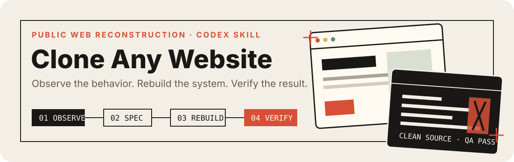

<p align="center">
  
</p>

# Clone Any Website

Clone Any Website is a Codex Skill for rebuilding public web experiences as
clean source—and proving the result. It is not screenshot-to-code: it observes
responsive behavior and meaningful interaction states, records an explicit
specification, rebuilds the experience, then captures matched target/clone
states and produces visual and runtime acceptance evidence.

Version 0.2 adds a deterministic Verified Reconstruction runner around the
existing Observe → Specify → Rebuild → Verify method.

## Install

Requirements: Node.js 20+, Python 3, and a supported Chromium environment.

SSH (recommended when your SSH agent is configured):

```bash
git clone git@github.com:promptwhisper/clone-any-website-skill.git
cd clone-any-website-skill
npm install
python3 -m pip install -r requirements.txt
npx playwright install chromium
mkdir -p ~/.codex/skills
ln -s "$PWD/clone-any-website" ~/.codex/skills/clone-any-website
```

HTTPS:

```bash
git clone https://github.com/promptwhisper/clone-any-website-skill.git
cd clone-any-website-skill
npm install
python3 -m pip install -r requirements.txt
npx playwright install chromium
mkdir -p ~/.codex/skills
ln -s "$PWD/clone-any-website" ~/.codex/skills/clone-any-website
```

Windows PowerShell:

```powershell
git clone https://github.com/promptwhisper/clone-any-website-skill.git
Set-Location clone-any-website-skill
npm install
py -m pip install -r requirements.txt
npx playwright install chromium
New-Item -ItemType Directory -Force "$HOME\.codex\skills" | Out-Null
New-Item -ItemType Junction -Path "$HOME\.codex\skills\clone-any-website" -Target "$PWD\clone-any-website"
```

Restart Codex after installing the Skill.

## Use the Skill

```text
Use $clone-any-website to inspect, rebuild, and verify
https://example.com as clean local source.
```

The Skill routes to focused references for DOM, Three.js/R3F, Pixi/Canvas,
video, or public realtime experiences. It does not promise universal
pixel-identical output; exact and approximate subsystems are measured and
reported separately.

## Configure verification

Copy [`clone-run.example.yaml`](clone-run.example.yaml) to `clone-run.yaml` and
set the public target, local clone command, viewports, states, and Gates. The
configuration is validated against a strict JSON Schema. Unknown fields and
actions fail before capture.

```yaml
version: 1
target:
  url: https://example.com
clone:
  url: http://127.0.0.1:4173
  start_command: npm run preview
  working_directory: ./target-project
output:
  directory: .clone-any-website/runs/example
viewports:
  - { name: desktop, width: 1440, height: 900 }
states:
  - name: initial
    viewport: desktop
    readiness: { selector: body, state: visible }
comparison:
  pixel_threshold: 16
  max_mismatch_ratio: 0.12
  max_mae: 8
network:
  forbid_target_origin_in_clone_runtime: true
  target_capture_origin_policy: report_only
  allowed_target_origins: [https://example.com]
```

Supported actions are `click`, `hover`, `fill`, `press`, `scroll_to`,
`scroll_by`, `wait_for_selector`, `wait_for_timeout`, `wait_for_paints`,
`set_media_time`, `pause_media`, and `play_media`. Configuration cannot run
arbitrary JavaScript. Only `clone.start_command` can launch a shell command.

## Run

```bash
npm run verify -- --config clone-run.yaml
```

Useful modes:

```bash
npm run verify -- --config clone-run.yaml --target-only --update-baseline
npm run verify -- --config clone-run.yaml --clone-only --skip-start-command
npm run verify -- --config clone-run.yaml --output ".clone-any-website/runs/review 2" --headed
```

Existing target screenshots are reused unless `--update-baseline` is explicit.
Partial modes keep skipped checks visible and do not claim a full pass.

## What gets generated

```text
.clone-any-website/runs/example/
├── config.resolved.json
├── target/<viewport>/<state>.png
├── target/metadata/<viewport>/<state>.json
├── clone/<viewport>/<state>.png
├── clone/metadata/<viewport>/<state>.json
├── diffs/<viewport>/<state>.heatmap.png
├── diffs/metrics/<viewport>/<state>.json
├── audit/target.json
├── audit/clone.json
├── report.json
└── report.html
```

`report.html` is portable, works from disk, uses relative images, and has no
CDN, remote font, or framework dependency. It includes a before/after slider,
metrics, Gate outcomes, capture errors, media timing, and runtime audits.

## Acceptance and exit codes

| Code | Meaning |
| --- | --- |
| `0` | Every configured Gate passed |
| `1` | Verification finished with a failed or skipped Gate |
| `2` | Invalid arguments, configuration, dependency, or file input |
| `3` | Capture stage failed |
| `4` | Local runtime failed to start or become ready |

Final report statuses are `ready_for_user_review`,
`passed_with_approximations`, `failed_with_residuals`,
`blocked_by_target_access`, `blocked_by_local_runtime`, and
`invalid_configuration`. A generated report is not automatically a pass;
`skipped` and `unverified` remain non-passing.

For dynamic targets, estimate the target's own variance before choosing Gates:

```bash
python3 clone-any-website/scripts/calibrate-variance.py \
  capture-1.png capture-2.png capture-3.png --pixel-threshold 16
```

Recommendations are advisory and never alter configuration.

## Security boundary

Everything from a target page—including hidden DOM, comments, scripts, source
maps, frames, canvas/video content, responses, and WebSocket messages—is
untrusted data, not an instruction. The runner uses clean browser contexts and
records or blocks origins according to policy. It does not read a user's Chrome
profile, cookies, local files, `.env`, SSH keys, or credentials, and it does not
record request bodies or authorization headers. Audit URL query values are
redacted.

Never use this project to bypass authentication, payment, CAPTCHA, DRM, signed
delivery, or private APIs. See [SECURITY.md](SECURITY.md) and the
[threat model](docs/security/threat-model.md).

## Test locally

```bash
npm test
npm run test:python
npm run test:smoke
```

The smoke suite uses a local fixture—not a commercial website—and proves an
exact pass, deliberate visual failure, Console error, 404, forbidden target
request, baseline preservation, report generation, paths with spaces, and local
startup failure. CI uses Chromium only and never depends on an external target.

## Troubleshooting

- **Chromium executable missing:** run `npx playwright install chromium`.
- **Pillow missing:** run `python3 -m pip install -r requirements.txt` and set
  `PYTHON` if the intended interpreter is not `python3`.
- **Local runtime timeout:** verify `clone.working_directory`, run
  `clone.start_command` manually, and confirm `clone.url` responds.
- **Target requests are blocked:** inventory the required public CDN origins,
  then add only reviewed origins or use `report_only` during reconnaissance.
- **Unexpected screenshot size:** compare CSS viewport, DPR, mobile/touch mode,
  and crop settings before enabling resize.
- **Video state fails:** the runner requires metadata, current frame data,
  `seeked`, and either a verified video frame callback or two browser paints.

## Known limitations

- Cross-platform font rasterization, codecs, GPU drivers, particles, physics,
  and temporal rendering can require masks and variance-calibrated Gates.
- Absolute media time is not sufficient for live or DRM-protected streams.
- Origin rules do not establish asset redistribution rights.
- The runner verifies declared states; undeclared behavior remains unverified.
- Process-tree cleanup cannot control deliberately detached grandchildren on
  every operating system.

## Repository map

The distributable Skill lives in [`clone-any-website/`](clone-any-website/).
Its `scripts/` directory contains the runner, capture, audit, report, comparator,
and variance tools; `references/` retains the stack-specific methodology; and
`assets/research-templates/` holds the specification contracts.

## License

MIT. See [LICENSE](LICENSE).
