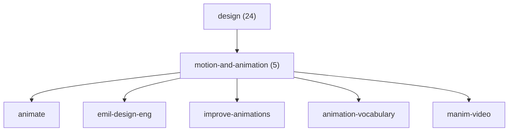

# The Agent Skills Ecosystem & Designing a Skills Knowledge Base

**Research date:** 2026-10-20 · **Machine:** Linux (Hermes Agent) · **Local skill count:** 108

All repository data below was fetched live from the GitHub API (`gh api repos/<owner>/<repo>`) on 2026-10-20. Specs were read from primary sources: `agentskills.io`, `code.claude.com/docs`, `docs.claude.com`, `cursor.com/docs`, `agents.md`, `modelcontextprotocol.io`. Repos that returned HTTP 404 are listed explicitly and **dropped**.

---

## 1. The Agent Skills Spec (the "open standard")

**Canonical location:** <https://agentskills.io/specification> — the spec was originally written by Anthropic, released as an open standard, and is now stewarded by the [`agentskills/agentskills`](https://github.com/agentskills/agentskills) repo (26,320 stars, Apache-2.0, last push 2026-08-09).

> Note: `anthropics/skills` has a `spec/agent-skills-spec.md` file whose entire body is a one-line pointer: *"The spec is now located at https://agentskills.io/specification"*. The live spec is the only authoritative source.

### 1.1 Directory structure

```
skill-name/
├── SKILL.md          # Required: metadata + instructions
├── scripts/          # Optional: executable code
├── references/       # Optional: documentation loaded on demand
├── assets/           # Optional: templates, resources
└── ...               # Any additional files or directories
```

### 1.2 Frontmatter fields (the canonical six)

The spec defines exactly **six** frontmatter fields. Two are **required**.

| Field | Required | Constraints |
|---|---|---|
| `name` | **Yes** | 1–64 chars; lowercase letters, digits, hyphens only; must not start/end with a hyphen; no consecutive hyphens; must match the parent directory name |
| `description` | **Yes** | 1–1024 chars; non-empty; must state both *what the skill does* and *when to use it*; include trigger keywords |
| `license` | No | License name or reference to a bundled license file (e.g. `Apache-2.0`, `Proprietary. LICENSE.txt has complete terms`) |
| `compatibility` | No | Max 500 chars; environment requirements (intended product, system packages, network access). "Most skills do not need this field." |
| `metadata` | No | Free-form map of string keys → string values, for client-specific data (e.g. `author`, `version`) |
| `allowed-tools` | No | Space-separated string of pre-approved tools. **Experimental** — support varies by client. Example: `allowed-tools: Bash(git:*) Bash(jq:*) Read` |

Minimal valid skill:
```yaml
---
name: skill-name
description: A description of what the skill does and when to use it.
---
```

Full example:
```yaml
---
name: pdf-processing
description: Extract PDF text, fill forms, merge files. Use when handling PDFs.
license: Apache-2.0
metadata:
  author: example-org
  version: "1.0"
---
```

### 1.3 Progressive disclosure (3 levels)

From `agentskills.io/specification#progressive-disclosure`:

1. **Metadata (~100 tokens)** — `name` + `description` loaded at startup for *all* skills.
2. **Instructions (<5,000 tokens recommended)** — the full `SKILL.md` body loads when the skill activates.
3. **Resources (as needed)** — `scripts/`, `references/`, `assets/` load only when required.

Hard rules that fall out of this:
- **Keep `SKILL.md` under 500 lines.** Move reference material to `references/`.
- **File references one level deep** from `SKILL.md`; avoid deeply nested reference chains.
- Reference files use **relative paths from the skill root**: `the reference guide at references/REFERENCE.md` (path example).
- Tell the agent *when* to read each file — *"Read `references/api-errors.md` if the API returns a non-200 status code"* — not a generic "see references/".

### 1.4 The length guidance — correction to the brief

The task brief cited a "5–10k **char**" guidance limit. The actual primary sources say something different, and the distinction matters for a generated index:

| Source | Actual guidance |
|---|---|
| `agentskills.io/specification` | `SKILL.md` under **500 lines**; body **<5,000 tokens** recommended |
| `agentskills.io/skill-creation/best-practices` | "keeping `SKILL.md` under **500 lines and 5,000 tokens**" |
| `anthropics/skills` → `skills/skill-creator/SKILL.md` | "**SKILL.md body** — in context whenever skill triggers (**<500 lines ideal**)" |
| `docs.claude.com` → Agent Skills best practices | "Keep SKILL.md body under **500 lines** for optimal performance" |

So the canonical limit is **500 lines / 5,000 tokens**, not 5–10k characters. A 5,000-token body is roughly **20,000 characters** of English prose. **5k–10k characters is the *comfort zone* for a well-behaved SKILL.md body** — it's well under the hard ceiling, and it matches the observed distribution of this machine's skills (see §5). Use 500 lines / 5,000 tokens as the *validation* rule and 5k–10k chars as the *target* rule.

> There is **no** official "one skill = one job" rule stated as such. The nearest normative statements, quoted verbatim from `agentskills.io/skill-creation/best-practices`:
> - *"Deciding what a skill should cover is like deciding what a function should do: you want it to encapsulate **a coherent unit of work** that composes well with other skills. Skills scoped too narrowly force multiple skills to load for a single task… Skills scoped too broadly become hard to activate precisely."*
> - *"A skill for querying a database and formatting the results may be one coherent unit, while a skill that also covers database administration is probably trying to do too much."*
>
> And from `anthropics/skills` → `skill-creator`: *"When a skill supports multiple domains/frameworks, organize by variant"* with `references/aws.md`, `references/gcp.md`, `references/azure.md` — one skill, multiple reference files.

### 1.5 Naming rules

From `docs.claude.com` best practices:
- Gerund form is recommended: `processing-pdfs`, `analyzing-spreadsheets`, `testing-code`.
- Acceptable: noun phrases (`pdf-processing`), action-oriented (`process-pdfs`).
- Avoid: vague names (`helper`, `utils`, `tools`), over-generic (`documents`, `data`, `files`).
- **Reserved words:** `anthropic` and `claude` are rejected in the `name` field (Claude API); `anthropic-skills` is a reserved folder name in Claude Code.

### 1.6 Description rules

- Write in **third person** — the description is injected into the system prompt.
  - Good: `"Processes Excel files and generates reports"`.
  - Bad: `"I can help you process Excel files"`.
- Include both *what* and *when*, with trigger keywords.
- **Anthropic-specific:** in Claude Code, `description` + `when_to_use` are truncated at **1,536 characters** in the skill listing.
- **Skill-creator's calibration tip:** Claude tends to *under*-trigger, so write descriptions "a little bit pushy" — name the domains and keywords explicitly.

### 1.7 Validation

```bash
skills-ref validate ./my-skill     # from agentskills/agentskills → skills-ref/
```
Checks frontmatter validity and naming conventions.

### 1.8 Claude Code extensions (beyond the six spec fields)

Claude Code accepts a **superset**. From `code.claude.com/docs/en/skills#frontmatter-reference` — all fields optional, `description` recommended:

| Field | Purpose |
|---|---|
| `name` | Command name shown in `/` menu. Defaults to directory name |
| `description` | What it does + when to use it |
| `when_to_use` | Extra trigger phrases; appended to `description`, counts toward the 1,536-char cap |
| `argument-hint` | Autocomplete hint, e.g. `[issue-number]` |
| `arguments` | Named positional args for `$name` substitution |
| `disable-model-invocation` | `true` = Claude can't auto-load it; manual `/name` only |
| `user-invocable` | `false` = hide from `/` menu; Claude-only invocation |
| `allowed-tools` | Pre-approve tools for the invoking turn |
| `disallowed-tools` | Remove tools from the pool while the skill is active |
| `model` | Model override for the turn |
| `effort` | `low`/`medium`/`high`/`xhigh`/`max` |
| `context` | `fork` → run in a forked subagent |
| `agent` | Which subagent type when `context: fork` |
| `background` | With `context: fork`, whether to wait for the result |
| `hooks` | Hooks registered on invocation |
| `paths` | Glob patterns limiting activation (same format as path-specific rules) |
| `shell` | `bash` (default) or `powershell` for `` !`cmd` `` blocks |
| `metadata` | Free-form map for your own tooling |
| `license` | Spec field |
| `compatibility` | Spec field |

**Portability rule (important for a cross-client knowledge base):** when uploading to claude.ai, the Skills API, or packaging with `package_skill.py`, **only these six are allowed**: `name`, `description`, `license`, `compatibility`, `metadata`, `allowed-tools`. Anything else is a **hard error**, not a warning:

```
Unexpected key(s) in SKILL.md frontmatter: argument-hint. Allowed properties are:
allowed-tools, compatibility, description, license, metadata, name
```

**Parsing gotcha:** Claude Code reads frontmatter **only if the opening `---` is the file's first line**. Otherwise the whole file, `---` markers included, is treated as skill content. If the YAML doesn't parse, the skill still loads **with no fields set** (silent failure).

---

## 2. Client Conventions

### 2.1 Claude Code — skills, commands, plugins

**Commands were merged into skills.** A file at `.claude/commands/deploy.md` and a skill at `.claude/skills/deploy/SKILL.md` both create `/deploy`. `.claude/commands/` still works, but supports the same frontmatter **except `name` and `paths`**.

**Where skills load:**

| Location | Path | Loads in |
|---|---|---|
| Enterprise | `.claude/skills/<name>/SKILL.md` (managed settings dir) | All users on managed machines |
| Personal | `~/.claude/skills/<name>/SKILL.md` | All your projects (not Cowork/cloud) |
| Project | `.claude/skills/<name>/SKILL.md` | Sessions in this repo |
| Nested | `<subdir>/.claude/skills/<name>/SKILL.md` | Sessions started in or below `<subdir>` |
| Additional dir | `--add-dir` / `/add-dir` | That session only |
| Plugin | `<plugin>/skills/<name>/SKILL.md` | Wherever the plugin is enabled, as `/plugin-name:skill-name` |
| claude.ai account | Skills enabled on your account | Cowork, cloud, and terminal sessions |

**Name-collision precedence:** enterprise > personal > project. A project skill replaces a bundled skill or built-in command (but not its aliases). Plugin skills are namespaced, so they always coexist.

**Plugin standard layout** (from `code.claude.com/docs/en/plugins-reference`):

```
deploy-tools/
├── .claude-plugin/plugin.json   # Manifest (optional)
├── skills/<name>/SKILL.md       # One dir per skill
├── commands/status.md           # Flat Markdown commands (prefer skills/ for new plugins)
├── agents/reviewer.md           # Agent Markdown files; subfolders are part of the agent name
├── hooks/hooks.json
├── monitors/monitors.json
├── output-styles/terse.md
├── themes/dracula.json
├── workflows/release-audit.js
├── bin/deploy-tool              # On the Bash tool's PATH while enabled
├── scripts/format.sh
├── settings.json
├── .mcp.json
└── .lsp.json
```

`plugin.json` keys: `$schema`, `name` (**required**, kebab-case), `displayName`, `version`, `description`, `author` (object), `homepage`, `repository`, `license`, `keywords`, `defaultEnabled`, `dependencies`, `metadata`, `skills`, `commands`, `agents`, `hooks`, `mcpServers`, `lspServers`, `outputStyles`, `experimental`, `userConfig`.
- Unrecognized **top-level** keys are silently stripped; unrecognized keys inside `userConfig`, `channels`, `lspServers`, or `monitors` are **hard errors**.
- Validate with `claude plugin validate ./my-plugin` (`--strict` for CI).
- A `CLAUDE.md` at plugin root is **not** loaded and triggers a validator warning.
- A plugin with `SKILL.md` at its root, no `skills/`, and no `skills` key loads as a **single skill**.

**Marketplace:** a repo with `.claude-plugin/marketplace.json` listing plugins and where to fetch them. It's a catalog, not a hosted store. `/plugin marketplace add <owner>/<repo>`.

**Dynamic context injection:** `` !`git diff HEAD` `` in a skill body is executed and replaced with its output *before* Claude sees the content.

**Bundled skills:** `/doctor`, `/code-review`, `/batch`, `/debug`, `/loop`, `/claude-api`, `/run`, `/verify`, `/simplify`, `/workflow-authoring`. Turn off with `disableBundledSkills`.

### 2.2 OpenAI / AGENTS.md

**Canonical:** <https://agents.md/> — "a simple, open format for guiding coding agents, used by over 60k open-source projects." Now stewarded by the **Agentic AI Foundation under the Linux Foundation**.

- Plain Markdown. **No required fields, no frontmatter, no schema** — "just standard Markdown. Use any headings you like."
- Put it at the repo root; for monorepos use **nested `AGENTS.md`** per package. **The closest file to the edited file wins.** (The OpenAI repo has 88 of them.)
- Popular sections: project overview, build/test commands, code style, testing instructions, security considerations.
- Agents **will** attempt to run testing commands listed there and fix failures before finishing.
- Explicit user chat prompts override everything.
- Backward-compat migration: `mv AGENT.md AGENTS.md && ln -s AGENTS.md AGENT.md`.
- Aider: `read: AGENTS.md` in `.aider.conf.yml`. Gemini CLI: `{"context": {"fileName": "AGENTS.md"}}` in `.gemini/settings.json`.
- Supported by: Codex, Jules, Factory, Aider, goose, opencode, Zed, Warp, VS Code, Devin, Amp, Cursor, RooCode, Gemini CLI, Kilo Code, Phoenix, Semgrep, GitHub Copilot, Windsurf, Augment Code, Junie, Ona, Autopilot, and others.

**Contrast with skills:** AGENTS.md is always-loaded project context. A skill is *loaded on demand*. The AGENTS.md site states the intent explicitly: keep READMEs human-focused and put *agent-specific* context in AGENTS.md.

### 2.3 Cursor rules — `.cursor/rules/*.mdc`

**Canonical:** <https://cursor.com/docs/context/rules> (note: `docs.cursor.com` now redirects to `cursor.com/docs`).

- Project rules live in `.cursor/rules/` as **`.mdc`** files, version-controlled. **A plain `.md` in `.cursor/rules` is ignored** — it has no frontmatter to specify `description`, `globs`, `alwaysApply`. Use `AGENTS.md` instead.
- `.cursor/rules/frontend/components.mdc` — folders are allowed for organization.
- Four rule types map onto three frontmatter fields:

| Rule Type | `alwaysApply` | `description` | `globs` |
|---|---|---|---|
| **Always Apply** | `true` | — | — (ignored) |
| **Apply to Specific Files** | `false` | provided | provided → auto-attached when a matching file is in context |
| **Apply Intelligently** | `false` | provided | omitted → Agent reads description and pulls it in when relevant |
| **Apply Manually** | `false` | omitted | omitted → included only on `@-mention` |

Examples:
```yaml
---
alwaysApply: true
---
```
```yaml
---
globs: src/components/**/*.tsx
alwaysApply: false
---
```
```yaml
---
description: RPC service conventions and patterns for the backend
alwaysApply: false
---
```

- **Glob syntax:** `*` = one path segment; `**` = any number of dirs; `*.ts` = root only; `**/*.ts` = any dir; `src/**`; `src/**/*.tsx`; comma-separated for multiples; `tailwind.config.*`.
- **Referenced files are NOT inlined.** `@migration-template.sql` tells Agent where to look; Agent reads it with its tools. Put anything that must always be in context directly in the rule body.
- **Best practice:** keep rules under 500 lines; split large rules into composable ones; reference files instead of copying contents.
- **Team Rules** (Team/Enterprise): dashboard-managed, free-form text (no folder structure), support globs, can be **enforced** (users cannot disable).
- **Precedence:** Team Rules → Project Rules → User Rules. All applicable rules merge; earlier sources win on conflict.
- **User Rules**: global preferences from Customize → Rules, apply across all projects.
- **Importing rules from a repo:** rules aren't imported standalone — package them in a plugin published via a marketplace (`.cursor-plugin/marketplace.json`).
- Cursor also supports **AGENTS.md** at root and subdirectories, **Skills**, **Subagents**, **Hooks**, **Plugins**, **MCP**, and **Cloud Agents**.

### 2.4 Client support matrix for Agent Skills

From `agentskills.io/clients` (partial list): nanobot, Roo Code, GitHub Copilot, Amp, Goose, Firebender, Kiro, Junie, OpenClaw, Autohand Code CLI, Ona, Snowflake Cortex Code, Factory, Mux, Letta, and more. The format is now genuinely cross-client, not Anthropic-only.

---

## 3. MCP Registries

MCP servers are **not** skills, but they are the adjacent ecosystem and are commonly cited alongside skill collections. Four registries, with live counts measured 2026-10-20:

| Registry | URL | Live count | What it offers |
|---|---|---|---|
| **Official MCP Registry** | `registry.modelcontextprotocol.io` | **≥1,200 entries / 281 unique server names** (paginated 12×100; cap is not the true total) | The official centralized metadata repo, backed by Anthropic, GitHub, PulseMCP, Microsoft. Standardized `server.json` with unique name (`io.github.user/server-name`), install location (npm package / remote URL), execution instructions (args, env vars), capabilities. **DNS-verified namespace ownership.** REST API for clients/aggregators. Currently in **preview** — breaking changes and data resets possible. |
| **Smithery** | `smithery.ai` | **15,426 servers** | Marketplace with per-server usage counts, categories, "verified" badges, managed hosting. **⚠️ MCP Proxy and managed identity shut down October 31** (per the site's own banner). |
| **mcp.so** | `mcp.so` | **19,357 servers** (`/api/mcp-servers` → `total`) | Agent-native directory. Also indexes **Skills**, Agents, Loops, Clients, Remote Servers, Rankings. Has a CLI. |
| **Glama** | `glama.ai/mcp/servers` | **107,302 servers** | Deepest directory by count. Rich facet filters: language (Python 45,002 / TypeScript 38,606), Remote vs Local, tools/resources/prompts counts, claimed/official status, 25+ categories (Developer Tools 25,731, AI & ML 7,809, Browser Automation 5,282, Image & Video Processing 3,991…). Also hosts an **MCP Inspector**, Connectors, and a `GET /v1/servers` directory API. |

**Registry ecosystem model** (from `modelcontextprotocol.io/registry/about`):
- The **official registry hosts metadata**, not code. npm/PyPI/Docker Hub host the packages; the registry points at them.
- Metadata is **deliberately unopinionated**; downstream aggregators add curation and ratings.
- Aggregators are expected to poll on "a regular but infrequent basis (for example, once per hour)".
- **No private servers.** Private deployments need a self-hosted registry.
- Server authenticity is verified via DNS + security scanning + spam moderation.

---

## 4. Verified Ecosystem Repositories

All confirmed via the GitHub API. `stars` and `pushed_at` are as of 2026-10-20.

### 4.1 Core / official

| Repo | Stars | Last push | License | Notes |
|---|---:|---|---|---|
| [`agentskills/agentskills`](https://github.com/agentskills/agentskills) | 26,320 | 2026-08-09 | Apache-2.0 | **The spec.** `docs/specification.mdx`, `docs/skill-creation/*`, `skills-ref` validator |
| [`anthropics/skills`](https://github.com/anthropics/skills) | 182,372 | 2026-10-09 | none (mixed) | Anthropic's reference skills. **20 `SKILL.md`** + `spec/` + `template/` |
| [`anthropics/claude-code`](https://github.com/anthropics/claude-code) | 152,871 | 2026-10-19 | none | The CLI |
| [`anthropics/claude-plugins-official`](https://github.com/anthropics/claude-plugins-official) | 43,289 | 2026-10-20 | Apache-2.0 | Official plugin directory |
| [`anthropics/claude-cookbooks`](https://github.com/anthropics/claude-cookbooks) | 53,595 | 2026-10-17 | MIT | Notebooks/recipes |
| [`anthropics/prompt-eng-interactive-tutorial`](https://github.com/anthropics/prompt-eng-interactive-tutorial) | 38,673 | 2026-08-28 | none | Prompt engineering tutorial |
| [`anthropics/claude-quickstarts`](https://github.com/anthropics/claude-quickstarts) | 18,890 | 2026-10-08 | MIT | *(note: `anthropics/anthropic-quickstarts` redirects here)* |

### 4.2 Curated awesome-lists & marketplaces

| Repo | Stars | Last push | Skills | Notes |
|---|---:|---|---:|---|
| [`obra/superpowers`](https://github.com/obra/superpowers) | **302,361** | 2026-10-20 | 15 | Agentic skills framework + methodology. `skills/` flat layout |
| [`mattpocock/skills`](https://github.com/mattpocock/skills) | 298,046 | 2026-10-19 | — | "Skills for Real Engineers" |
| [`affaan-m/ECC`](https://github.com/affaan-m/ECC) | 284,420 | 2026-10-20 | — | Agent harness performance system: skills, instincts, memory, security |
| [`JuliusBrussee/caveman`](https://github.com/JuliusBrussee/caveman) | 113,758 | 2026-10-19 | — | Token-reduction skill + proxy (claims ~65% savings) |
| [`addyosmani/agent-skills`](https://github.com/addyosmani/agent-skills) | 108,777 | 2026-10-13 | — | Production-grade engineering skills |
| [`Leonxlnx/taste-skill`](https://github.com/Leonxlnx/taste-skill) | 99,614 | 2026-10-19 | — | Art direction / reference images / browser check |
| [`ComposioHQ/awesome-claude-skills`](https://github.com/ComposioHQ/awesome-claude-skills) | 77,481 | 2026-09-18 | **864** | Largest skill dump; mostly Composio per-app automations |
| [`hesreallyhim/awesome-claude-code`](https://github.com/hesreallyhim/awesome-claude-code) | 56,700 | 2026-10-20 | — | Curated resources for Claude Code |
| [`coreyhaines31/marketingskills`](https://github.com/coreyhaines31/marketingskills) | 55,603 | 2026-10-19 | — | CRO, copywriting, SEO, growth |
| [`kepano/obsidian-skills`](https://github.com/kepano/obsidian-skills) | 49,800 | 2026-09-15 | — | Obsidian CLI + open formats |
| [`K-Dense-AI/scientific-agent-skills`](https://github.com/K-Dense-AI/scientific-agent-skills) | 53,118 | 2026-10-19 | — | Scientific domain library |
| [`Shubhamsaboo/awesome-llm-apps`](https://github.com/Shubhamsaboo/awesome-llm-apps) | 142,367 | 2026-10-18 | — | 100+ agents/skills/RAG apps |
| [`wshobson/agents`](https://github.com/wshobson/agents) | 41,212 | 2026-10-19 | **185** | Multi-harness plugin marketplace; `plugins/<plugin>/skills/<skill>/SKILL.md` |
| [`github/awesome-copilot`](https://github.com/github/awesome-copilot) | 40,214 | 2026-10-19 | — | Instructions, agents, skills, configs for Copilot |
| [`VoltAgent/awesome-agent-skills`](https://github.com/VoltAgent/awesome-agent-skills) | 36,043 | 2026-10-19 | — | **1,497+** skills badge. Hand-picked, not AI-slop. Categories: Official, AI & Agents, Developer Tools, Design, etc. Has an official MCP-servers companion repo |
| [`vercel-labs/skills`](https://github.com/vercel-labs/skills) | 35,761 | 2026-10-19 | — | The `npx skills` CLI — the de-facto skill installer |
| [`vercel-labs/agent-skills`](https://github.com/vercel-labs/agent-skills) | 32,695 | 2026-10-14 | — | Vercel's official skill collection |
| [`mvanhorn/last30days-skill`](https://github.com/mvanhorn/last30days-skill) | 64,832 | 2026-10-18 | — | Multi-source research skill |
| [`blader/humanizer`](https://github.com/blader/humanizer) | 58,691 | 2026-10-16 | — | Strips AI-isms from text |
| [`microsoft/skills`](https://github.com/microsoft/skills) | 3,135 | 2026-10-18 | — | Skills + MCP servers + agents + AGENTS.md for SDKs |
| [`davila7/claude-code-templates`](https://github.com/davila7/claude-code-templates) | 32,777 | 2026-10-20 | — | CLI for configuring Claude Code |
| [`alirezarezvani/claude-skills`](https://github.com/alirezarezvani/claude-skills) | 28,439 | 2026-08-30 | — | 380+ skills across 30+ agents |
| [`travisvn/awesome-claude-skills`](https://github.com/travisvn/awesome-claude-skills) | 15,478 | 2026-04-28 | — | Older curation list |
| [`obra/superpowers-marketplace`](https://github.com/obra/superpowers-marketplace) | 1,302 | 2026-10-10 | — | Curated plugin marketplace |
| [`steipete/agent-rules`](https://github.com/steipete/agent-rules) | 5,677 | 2026-05-03 | — | ⚠️ **Archived** — rules & knowledge for Claude Code/Cursor |

### 4.3 MCP ecosystem

| Repo | Stars | Last push | Notes |
|---|---:|---|---|
| [`punkpeye/awesome-mcp-servers`](https://github.com/punkpeye/awesome-mcp-servers) | 96,649 | 2026-10-18 | MIT. The canonical MCP server list |
| [`modelcontextprotocol/servers`](https://github.com/modelcontextprotocol/servers) | 91,402 | 2026-10-19 | Reference server implementations |
| [`modelcontextprotocol/registry`](https://github.com/modelcontextprotocol/registry) | 7,383 | 2026-10-14 | The official registry service |

### 4.4 Verified 404s — dropped

These were requested or plausible but **do not exist** on GitHub (HTTP 404 via `gh api`). They are excluded from all tables above:

`anthropics/anthropic-cookbook` (301 → redirects to `anthropics/claude-cookbooks`), `openai/openai-cookbooks`, `vercel/agent-skills`, `DisjointedMess/awesome-copilot-guides`, `mrsimpson/claude-code-security`, `swyxio/superpowers`, `jetbrains/jb-skills`, `adamwathan/agent-skills`, `pavel-uk/prompt-template`, `skills-sh/skills`, `skillssh/skills`, `Siuolheung/awesome-skills`, `danielscholl/awesome-claude-code`, `bennywong/claude-skills`, `jeremymoritz/Claude-Skills`, `StanHypothesis/claude-code-skills`, `guangzhengli/Claude-Code-Plugin-Development`, `bazil3000/xurl-tools`.

Also: `modelcontextprotocol.io/docs/guides/registry` → **404**; the correct paths are `modelcontextprotocol.io/registry/about`, `/registry/quickstart`, `/registry/aggregators`.

---

## 5. This Machine's Installed Skills — Measured Baseline

**108 skills** in `/home/youssefvdel/.hermes/skills`. Measured by walking the tree and parsing frontmatter.

| Metric | Value |
|---|---|
| Total skills | 108 |
| Depth distribution | 38 at depth 1 (flat), 70 at depth 2 (one category dir + skill dir) |
| Top-level groups | 50 |
| Skills with supporting files | 47 |
| `description` present | 108 / 108 (100%) |
| `name` present | 108 / 108 (100%) |
| `license` | 92 |
| `version` | 88 |
| `author` | 84 |
| `metadata` | 82 |
| `platforms` | 72 |
| `prerequisites` | 12 |
| Body size | min 1,231 · **median 8,291** · mean 9,849 · max 36,719 chars |

**The median body of 8,291 chars sits right in the 5k–10k comfort band** — the corpus is well-calibrated against the 500-line/5,000-token ceiling. The max (36,719, `creative/humanizer`) is an outlier that would benefit from splitting into `references/`.

**Current grouping (as installed):**
```
software-development 19 │ productivity 16 │ creative 11 │ autonomous-ai-agents 5
apple 4 │ email 4 │ research 4 │ media 3 │ devops 1 │ note-taking 1 │ social-media 1 │ web 1
+ 34 singletons (frontend-design, impeccable, taste-skill, ui-ux-*, kowalski-*, tauri-*, ...)
```

**Two structural problems visible in the raw tree:**

1. **38 of 108 skills (35%) are orphans at depth 1**, while only 7 categories exist. The tree is 50 groups for 108 skills — a mean of 2.16 skills per group, which is too flat to navigate and too uneven to be a taxonomy. Notably `creative/` holds 11 skills while `apple-design`, `brand-guidelines`, `canvas-design`, `frontend-design`, `theme-factory`, `taste-skill`, and the entire `ui-ux-*` / `ux-design-pro-max` / `impeccable` / `kowalski-*` cluster (16 skills) sit *outside* it.
2. **A genuine duplicate**: `impeccable` and `creative/impeccable` both declare `name: impeccable` (12,261 vs 12,495 chars; the root one has **no** supporting files, the nested one has 56). Under the spec, `name` must match the parent directory name and be unique — this is a live collision that a generated index must flag.

**Other spec deviations worth noting:** 7 skills have `name` ≠ directory name (`ui-ux-pro-max-plus`→`ui-ux-pro-max`, `taste-skill`→`design-taste-frontend`, `kowalski-design-eng`→`emil-design-eng`, `kowalski-animation-vocabulary`→`animation-vocabulary`, `vercel-web-design-guidelines`→`web-design-guidelines`, `kowalski-improve-animations`→`improve-animations`, `kowalski-animate`→`animate`). The local corpus also uses non-spec keys — `version`, `author`, `platforms`, `prerequisites` — which are **not** portable to the claude.ai Skills API as top-level fields (they'd need to move under `metadata`). `platforms`, `version`, and `author` are already under `metadata.hermes` in most skills; `version`/`author` also appear top-level.

---

## 6. Proposed Hierarchy Scheme

### 6.1 The four levels

```
L1  domain          8 domains   — what area of work this is  (stable, slow-moving)
L2  sub-domain      ~30 groups  — a coherent body of practice within the domain
L3  capability      ~60 groups  — a repeatable task class ("design a UI", "debug a runtime")
L4  skill           108 leaves  — one specific, loadable skill
```

Paths: `domain / sub-domain / capability / skill-name` (kebab-case, lowercase, hyphen-separated — matching the spec's `name` rules so the tree is directly loadable).

### 6.2 The eight domains

| # | Domain | Rationale |
|---|---|---|
| 1 | `engineering` | Writing, debugging, reviewing, shipping code |
| 2 | `frontend` | UI implementation, styling, component architecture |
| 3 | `design` | Visual direction, art direction, design systems, motion/animation |
| 4 | `data-and-documents` | Office docs, PDFs, spreadsheets, presentations, KBs |
| 5 | `platform-and-ops` | Servers, email infra, desktop/OS, cloud, security |
| 6 | `integrations` | External APIs and services — mail, notes, workspace SaaS, social |
| 7 | `research-and-knowledge` | Finding, reading, citing, monitoring sources |
| 8 | `agent-craft` | How to build/use/direct agents themselves — the meta layer |

### 6.3 The placement rule (deterministic, in priority order)

Apply **the first rule that matches**. Every rule is a predicate over the skill's frontmatter, so the tree can be generated with a script rather than hand-curated.

**Step 0 — Normalize.** Read `SKILL.md`; parse frontmatter; take `description` as the primary semantic signal and `metadata.hermes.tags` / `metadata.hermes.category` as secondary. Strip the `name`-vs-directory mismatch (§5).

**Step 1 — Meta layer first.** If the skill's *subject* is an AI agent or agent tooling itself (Claude Code, Codex, OpenCode, Hermes, MCP, computer-use, skill authoring, codex/opencode delegation) → **`agent-craft`**, L2 = the specific agent or concept (`agent-craft / coding-agents / <agent>`).
> *Why first:* an agent-delegation skill is not "engineering" — it is about agents. Placing it under engineering would bury it.

**Step 2 — Media artifacts.** If the skill's *primary output* is an image, video, animation, audio, or diagram → **`design`**, L2 = output medium (`design / motion-and-animation / …`, `design / static-visual / …`, `design / audio-and-music / …`).
> *Why before engineering:* `p5js`, `manim-video`, `ascii-video`, `algorithmic-art`, `canvas-design` are creative-coding, not app engineering. Their L3 is the technique (`generative-art`, `math-animation`, `ascii-rendering`, `infographics`, `diagrams`).

**Step 3 — User-facing artifact.** If the skill's primary output is a document, deck, spreadsheet, PDF, or knowledge base → **`data-and-documents`**, L2 = format (`word`, `pdf`, `slides`, `spreadsheets`, `knowledge-management`).

**Step 4 — User-facing interface.** If the skill designs, critiques, or specifies a user interface → **`design`**, L2 = `design-system` or `product-ui`. If it *implements* UI in code (React components, CSS, web platform) → **`frontend`**, L2 = `implementation` or `platform-guidelines`.
> *Why the split:* `impeccable`/`ui-ux-craft-kit`/`taste-skill`/`ux-design-pro-max` are **design decisions**; `react-best-practices`/`frontend-design`/`vercel-web-design-guidelines` are **code-level**. Both are "frontend" colloquially but they serve different phases of the workflow and should not share a folder.

**Step 5 — External service.** If the skill's object of work is a third-party service (an API, a CLI, a SaaS, an OS) → **`integrations`**, L2 = the service family (`email`, `workspace-saas`, `notes-and-pkm`, `social-platforms`, `apple-ecosystem`).
> *Why:* `himalaya`, `notion`, `obsidian`, `xurl`, `imessage`, `airtable` all talk to an external system. Grouping by *what they talk to* beats grouping by protocol.

**Step 6 — Runtime/host.** If the skill's object of work is the machine or a running process (Linux/WSL, Windows, Tauri, Electron, Rust/Go, servers) → **`platform-and-ops`**, L2 = `systems` / `desktop-apps` / `language-tooling` / `infrastructure`.

**Step 7 — Practice/method.** If the skill teaches a *method* rather than operating a system (TDD, systematic debugging, code review, planning) → **`engineering`**, L2 = `practice` / `quality` / `workflow`.

**Step 8 — Knowledge.** If the skill finds, reads, cites, or monitors information → **`research-and-knowledge`**, L2 = `discovery` / `synthesis` / `monitoring`.

**Step 9 — Residual.** Anything unclassified goes to `agent-craft / uncategorized` and is **flagged in CI**. No skill should need this bucket after the first pass.

**Within an L2, L3 is chosen by the *action* the skill performs**, using a controlled vocabulary: `create`, `analyze`, `audit`, `debug`, `refactor`, `deploy`, `monitor`, `integrate`, `review`, `automate`, `teach`, `plan`. L3 must have **≥2 skills**; singletons collapse into the parent L2 to avoid a 1:1 level that adds no navigational value. This keeps the tree 4 levels only where it earns them.

**Tie-break within an L3:** alphabetical by skill `name`.

### 6.4 Worked example — the 108 skills placed

```
engineering/
  practice/          test-driven-development, systematic-debugging, simplify-code,
                     requesting-code-review, spike, ponytail, codebase-inspection,
                     dogfood, devops/sdlc-review
  debugging/         python-debugpy, node-inspect-debugger, live-view-flicker
  quality/           github, static-site-ci-deploy, usb-hid-recovery
  architecture/      system-architect
  language-tooling/  go-cli, rust-cli, rust-fuse-filesystem

frontend/
  implementation/    react-best-practices
  platform-guidelines/ vercel-web-design-guidelines
  browser-automation/ browser-automation, browser-file-harvest, stealth-browser,
                       web/blocked-page-recovery
  extensions/        chromium-extension
  webview-desktop/   webview-desktop-shipping

design/
  design-system/     design-md, theme-factory, brand-guidelines, apple-design,
                     creative/popular-web-designs
  product-ui/        impeccable, ui-ux-craft-kit, ui-ux-pro-max-plus,
                     ux-design-pro-max, ui-ux-dev-paid
  art-direction/     taste-skill, creative/claude-design
  motion-and-animation/ kowalski-animate, kowalski-animation-vocabulary,
                     kowalski-improve-animations, kowalski-design-eng,
                     creative/manim-video
  generative-art/    algorithmic-art, creative/p5js
  static-visual/     canvas-design, creative/architecture-diagram,
                     creative/baoyu-infographic
  video-and-audio/   creative/ascii-video, media/gif-search, media/songsee,
                     songwriting-and-ai-music

data-and-documents/
  word/              productivity/docx, productivity/word-online-editing
  pdf/               productivity/pdf
  slides/            productivity/powerpoint
  spreadsheets/      productivity/xlsx
  knowledge-management/ note-taking/obsidian, research/llm-wiki
  extraction/        productivity/document-to-action-items,
                     productivity/meeting-action-items

platform-and-ops/
  systems/           software-development/linux-system-administration,
                     windows-interop, windows-workstation-setup
  desktop-apps/      tauri-v2, tauri-live-debug
  infrastructure/    mail-server-ops, email/self-hosted-mail-server
  browser-platform/  (see frontend/browser-automation)

integrations/
  email/             email/himalaya, email/email-inbox-triage,
                     email/custom-domain-email
  workspace-saas/    productivity/notion, productivity/airtable, productivity/box,
                     productivity/google-workspace, productivity/maps,
                     productivity/teams-meeting-pipeline
  notes-and-pkm/     note-taking/obsidian (if not claimed above)
  social-platforms/  social-media/xurl
  apple-ecosystem/   apple/imessage, apple/apple-notes, apple/apple-reminders,
                     apple/findmy
  product-apis/     riot-client-api, riot-client-local-api, recon-pure-vpn

research-and-knowledge/
  discovery/         research/arxiv
  synthesis/         research/grounded-citations, research/llm-wiki
  monitoring/        research/competitor-news-monitor,
                     productivity/product-price-monitor
  productivity-planning/ productivity/weekly-review-planning,
                     productivity/academic-project-delivery
  content/           media/youtube-content, creative/humanizer

agent-craft/
  coding-agents/     autonomous-ai-agents/{claude-code, codex, opencode, computer-use},
                     hermes-agent
  skill-authoring/   software-development/hermes-agent-skill-authoring
  provider-protocols/ provider-recon, protocol-translation
  naming/            name-availability
```

*(This mapping is the author's proposal; the generator script should encode these decisions as an explicit override table so a human can audit every placement.)*

### 6.5 Anti-patterns to avoid

- **Don't mirror the filesystem.** The install tree is a *storage* artifact, not a taxonomy. `apple/` as a domain is wrong — Apple Notes and iMessage are integrations; `apple-design` is design.
- **Don't create L3 singletons.** A level that always contains one child is just a rename.
- **Don't use the skill's own name as its category.** `ui-ux-pro-max-plus` isn't a category.
- **Don't split by tool when you can split by intent.** `python-debugpy` + `node-inspect-debugger` under L2 `debugging` beats L2 `python` + L2 `node`.
- **Don't let the L2 be a technology** unless the technology *is* the job (Rust CLI building, Tauri IPC).

---

## 7. Machine-Readable Index Format

### 7.1 Schema (JSON Schema, draft 2020-12)

```json
{
  "$schema": "https://json-schema.org/draft/2020-12/schema",
  "$id": "https://example.org/skills-index.schema.json",
  "title": "Agent Skills Knowledge Base Index",
  "type": "object",
  "required": ["schema_version", "generated_at", "roots", "skills"],
  "properties": {
    "schema_version": { "type": "string", "pattern": "^\\d+\\.\\d+$" },
    "generated_at":  { "type": "string", "format": "date-time" },
    "generator":     { "type": "string" },
    "roots": {
      "type": "array",
      "items": { "$ref": "#/$defs/root" }
    },
    "skills": {
      "type": "array",
      "items": { "$ref": "#/$defs/skill" }
    },
    "warnings": {
      "type": "array",
      "items": { "$ref": "#/$defs/warning" }
    }
  },
  "$defs": {
    "frontmatter": {
      "type": "object",
      "description": "Raw frontmatter as parsed from SKILL.md, plus derived flags.",
      "properties": {
        "name":              { "type": "string", "maxLength": 64 },
        "description":       { "type": "string", "maxLength": 1024 },
        "license":           { "type": ["string", "null"] },
        "compatibility":     { "type": ["string", "null"], "maxLength": 500 },
        "allowed_tools":     { "type": ["string", "array", "null"] },
        "metadata":          { "type": ["object", "null"] },
        "version":           { "type": ["string", "null"] },
        "author":            { "type": ["string", "null"] },
        "platforms":         { "type": ["array", "null"] },
        "prerequisites":     { "type": ["array", "null"] },
        "tags":              { "type": "array", "items": { "type": "string" } },
        "related_skills":    { "type": "array", "items": { "type": "string" } },
        "hermes_category":   { "type": ["string", "null"] },
        "raw_keys":          { "type": "array", "items": { "type": "string" } }
      },
      "additionalProperties": true
    },
    "skill": {
      "type": "object",
      "required": ["id", "path", "name", "description", "taxonomy"],
      "properties": {
        "id":          { "type": "string", "description": "L1/L2/L3/L4 slash path" },
        "name":        { "type": "string" },
        "slug":        { "type": "string" },
        "description": { "type": "string" },
        "path":        { "type": "string", "description": "Filesystem path to SKILL.md" },
        "source_root": { "type": "string", "description": "Install root (e.g. hermes, claude, plugin)" },
        "origin":      { "type": "string", "enum": ["local", "ecosystem"] },
        "taxonomy": {
          "type": "object",
          "required": ["domain", "sub_domain", "capability"],
          "properties": {
            "domain":     { "type": "string" },
            "sub_domain": { "type": "string" },
            "capability": { "type": ["string", "null"] },
            "rule_id":    { "type": "string", "description": "Which placement rule fired" },
            "confidence": { "type": "number", "minimum": 0, "maximum": 1 }
          }
        },
        "frontmatter": { "$ref": "#/$defs/frontmatter" },
        "metrics": {
          "type": "object",
          "properties": {
            "body_chars":   { "type": "integer" },
            "body_lines":   { "type": "integer" },
            "body_tokens_est": { "type": "integer" },
            "frontmatter_chars": { "type": "integer" },
            "supporting_files": { "type": "integer" },
            "references":   { "type": "integer" },
            "scripts":      { "type": "integer" },
            "assets":       { "type": "integer" },
            "has_reference_links": { "type": "boolean" }
          }
        },
        "spec_compliance": {
          "type": "object",
          "properties": {
            "spec_valid":          { "type": "boolean" },
            "name_matches_dir":    { "type": "boolean" },
            "name_valid":          { "type": "boolean" },
            "description_valid":   { "type": "boolean" },
            "description_third_person": { "type": "boolean" },
            "under_500_lines":     { "type": "boolean" },
            "under_5000_tokens":   { "type": "boolean" },
            "portable_to_api":     { "type": "boolean" },
            "violations":          { "type": "array", "items": { "type": "string" } }
          }
        },
        "ecosystem": {
          "type": "object",
          "description": "Only for origin=ecosystem",
          "properties": {
            "repo":   { "type": "string" },
            "url":    { "type": "string", "format": "uri" },
            "stars":  { "type": "integer" },
            "pushed_at": { "type": "string", "format": "date-time" },
            "license": { "type": ["string", "null"] },
            "verified": { "type": "boolean" }
          }
        },
        "links": {
          "type": "object",
          "properties": {
            "related": { "type": "array", "items": { "type": "string" } },
            "docs":    { "type": "array", "items": { "type": "string", "format": "uri" } }
          }
        }
      }
    },
    "root": {
      "type": "object",
      "required": ["path"],
      "properties": {
        "path":  { "type": "string" },
        "kind":  { "type": "string", "enum": ["hermes", "claude", "plugin", "cursor", "external"] }
      }
    },
    "warning": {
      "type": "object",
      "required": ["code", "message"],
      "properties": {
        "code":    { "type": "string" },
        "message": { "type": "string" },
        "skill_id": { "type": ["string", "null"] },
        "severity": { "type": "string", "enum": ["info", "warn", "error"] }
      }
    }
  }
}
```

### 7.2 Example entry (real skill from this machine)

```yaml
- id: design/motion-and-animation/kowalski-animate
  name: animate
  slug: kowalski-animate
  description: "Build an animation from scratch, making the decisions in the order that determines whether it feels right."
  path: /home/youssefvdel/.hermes/skills/kowalski-animate/SKILL.md
  source_root: hermes
  origin: local
  taxonomy:
    domain: design
    sub_domain: motion-and-animation
    capability: null
    rule_id: R2-media-artifact
    confidence: 0.92
  frontmatter:
    name: animate
    description: "Build an animation from scratch, making the decisions in the order that determines whether it feels right."
    license: null
    compatibility: null
    allowed_tools: null
    metadata: null
    version: null
    author: null
    platforms: null
    raw_keys: [name, description]
    tags: []
    related_skills: []
    hermes_category: null
  metrics:
    body_chars: 11779
    body_lines: 214
    body_tokens_est: 2945
    supporting_files: 0
    references: 0
    scripts: 0
    assets: 0
    has_reference_links: false
  spec_compliance:
    spec_valid: true
    name_matches_dir: false        # dir=kowalski-animate, name=animate
    name_valid: true
    description_valid: true
    description_third_person: true
    under_500_lines: true
    under_5000_tokens: true
    portable_to_api: true
    violations: ["name does not match parent directory name"]
  links:
    related: []
```

### 7.3 Canonical frontmatter fields to extract

**Tier 1 — required by the spec, always extract:**
`name`, `description`, `license`, `compatibility`, `metadata`, `allowed-tools`

**Tier 2 — Claude Code extensions, extract when present:**
`when_to_use`, `argument-hint`, `arguments`, `disable-model-invocation`, `user-invocable`, `disallowed-tools`, `model`, `effort`, `context`, `agent`, `background`, `hooks`, `paths`, `shell`

**Tier 3 — ecosystem / local extensions, extract when present:**
`version`, `author`, `platforms`, `prerequisites`, `tags`, `category`, `dependencies`, `environments`, `tools`, `triggers`, `required_credential_files`, `displayName`, `slug`, `summary`, `homepage`, `edition`

**Tier 4 — derived (computed by the generator, never read from the file):**
`body_chars`, `body_lines`, `body_tokens_est` (≈ chars/4), `frontmatter_chars`, `supporting_files`, `references_count`, `scripts_count`, `assets_count`, `has_reference_links`, `spec_valid`, `name_matches_dir`, `under_500_lines`, `under_5000_tokens`, `portable_to_api`, `violations[]`

**Also parse from the body (not frontmatter) for the index:**
- Markdown links to `references/*.md`, `scripts/*`, `assets/*` → the progressive-disclosure graph.
- First `#` heading → a human title, when it differs from `name`.
- Code-fence language distribution → a "produces" signal for taxonomy (e.g. mostly `python` + `bash` → `automate`; mostly `html` → `create`).

---

## 8. Generated-Tree Rendering

### 8.1 Rendering algorithm

1. **Discover** — walk each configured root for `**/SKILL.md`.
2. **Parse** — extract frontmatter, body stats, reference links.
3. **Place** — run the placement rules (§6.3) in order; record `rule_id` + `confidence`. A curated `overrides.yaml` takes precedence over the rules and records a reason.
4. **Validate** — emit warnings: duplicate `name`, `name` ≠ directory, >500 lines, >5,000 tokens, non-spec top-level keys, description >1,024 chars, missing `description`.
5. **Emit** — `index.yaml`, `index.json`, `TREE.md`, `index.html`, and `skills/<id>.md` pages.

### 8.2 `TREE.md` output shape

```markdown
# Skill Knowledge Base

108 skills · 8 domains · 30 sub-domains · generated 2026-10-20T13:42:00Z

## design (24 skills)
### motion-and-animation (5)
- **animate** — Build an animation from scratch, making the decisions in the order…
  `design/motion-and-animation/animate` · 11.8k chars · MIT · [SKILL.md](…)
```

### 8.3 Mermaid tree



### 8.4 Generator implementation notes

- **Frontmatter parsing:** use a real YAML parser (`yaml.safe_load` / `js-yaml`), never regex. Handle the spec's strictness: `---` must be the first line; unparseable YAML must be reported, not swallowed.
- **Booleans:** the spec accepts `yes/no/on/off/1/0` in any case in addition to `true/false`. Normalize case-insensitively.
- **`allowed-tools`:** space-separated string *or* YAML list — normalize to a list.
- **`metadata`:** map of string→string per spec; drop non-string values into `metadata_extra` rather than failing.
- **Token estimate:** `body_chars / 4` is close enough for a threshold check at 5,000; flag anything between 4,000 and 6,000 for a real tokenizer.
- **Incremental mode:** hash each `SKILL.md` and only re-parse changed ones; cache in `index.cache.json`.
- **CI gate:** fail the build on `spec_valid: false` for skills under version control; warn on length overruns.
- **Validate with the real tool:** `skills-ref validate <dir>` from `agentskills/agentskills` — the generator should shell out to it rather than reimplement the rules.
- **Ecosystem side:** a separate script hits `gh api repos/<owner>/<repo>` for stars/pushed_at and refreshes the `ecosystem` block; cache with a TTL of 24h and record `verified: true` only on a 200.

---

## 9. Top 20 Ecosystem Skills for Frontend / Animation / Design

Verified 2026-10-20. Sorted by stars. "Local?" = whether an equivalent is already installed on this machine.

| # | Repo | Stars | Last push | What it gives | Local? |
|---:|---|---:|---|---|---|
| 1 | [`Leonxlnx/taste-skill`](https://github.com/Leonxlnx/taste-skill) | **99,614** | 2026-10-19 | Art direction, reference images, browser check — anti-AI-slop | ✅ `taste-skill` |
| 2 | [`Nutlope/hallmark`](https://github.com/Nutlope/hallmark) | **30,422** | 2026-08-06 | Anti-AI-slop design skill for Claude Code / Cursor / Codex | ❌ |
| 3 | [`alchaincyf/huashu-design`](https://github.com/alchaincyf/huashu-design) | **25,475** | 2026-10-17 | HTML-native design skill: hi-fi prototypes, slides, animation + 20 design philosophies | ❌ |
| 4 | [`tt-a1i/archify`](https://github.com/tt-a1i/archify) | **86,087** | 2026-10-20 | Turn any idea/codebase into a beautiful interactive diagram | ❌ |
| 5 | [`greensock/gsap-skills`](https://github.com/greensock/gsap-skills) | **16,711** | 2026-07-29 | **Official GSAP skills** — correct GSAP usage for agents | ❌ **high value** |
| 6 | [`google-labs-code/stitch-skills`](https://github.com/google-labs-code/stitch-skills) | **8,547** | 2026-08-17 | Agent Skills for the Stitch MCP server (Google Labs) | ❌ |
| 7 | [`remotion-dev/skills`](https://github.com/remotion-dev/skills) | **5,410** | 2026-10-19 | **Official Remotion skills** — programmatic video | ❌ **high value** |
| 8 | [`JimLiu/baoyu-design`](https://github.com/JimLiu/baoyu-design) | **4,423** | 2026-09-23 | Run Claude Design locally as an Agent Skill — UI mockups, prototypes, decks | ❌ |
| 9 | [`kaankiziltug/logo-design-skill`](https://github.com/kaankiziltug/logo-design-skill) | **3,807** | 2026-10-20 | Logo design: principles, process, SVG craft, testing | ❌ |
| 10 | [`bergside/awesome-design-skills`](https://github.com/bergside/awesome-design-skills) | **3,272** | 2026-06-28 | 67 curated DESIGN.md + SKILL.md design files (Claude Design, Stitch, Codex) | ❌ |
| 11 | [`dominikmartn/nothing-design-skill`](https://github.com/dominikmartn/nothing-design-skill) | **2,832** | 2026-04-01 | UI in the Nothing design language — monochrome, typographic, industrial | ❌ |
| 12 | [`plugin87/ux-ui-agent-skills`](https://github.com/plugin87/ux-ui-agent-skills) | **2,437** | 2026-10-20 | DTCG tokens, 52 components, WCAG 2.2 AA–AAA, 138 design systems | ✅ ~`ui-ux-craft-kit` |
| 13 | [`Trystan-SA/claude-design-system-prompt`](https://github.com/Trystan-SA/claude-design-system-prompt) | **2,005** | 2026-07-06 | Opinionated, accessibility-aware design system prompt + skill library | ❌ |
| 14 | [`oil-oil/oil-ui`](https://github.com/oil-oil/oil-ui) | **1,892** | 2026-10-18 | UI design skill: explore distinct directions, compare side by side | ❌ |
| 15 | [`dickwu/apple-design-skill`](https://github.com/dickwu/apple-design-skill) | **1,670** | 2026-10-15 | Cross-platform UI/UX design reviewer based on Apple HIG | ✅ ~`apple-design` |
| 16 | [`twostraws/SwiftUI-Agent-Skill`](https://github.com/twostraws/SwiftUI-Agent-Skill) | **6,265** | 2026-10-16 | SwiftUI skill for Claude Code, Codex, and others | ❌ |
| 17 | [`wilwaldon/Claude-Code-Frontend-Design-Toolkit`](https://github.com/wilwaldon/Claude-Code-Frontend-Design-Toolkit) | **1,203** | 2026-04-11 | Toolkit of skills/plugins/MCP that make Claude Code output better frontends | ❌ |
| 18 | [`iart-ai/motion-skills`](https://github.com/iart-ai/motion-skills) | **910** | 2026-10-14 | 50 skills for motion graphics, animation & video; kinetic typography | ❌ **high value** |
| 19 | [`superdesigndev/superdesign-skill`](https://github.com/superdesigndev/superdesign-skill) | **857** | 2026-08-21 | "Stop shipping AI-slop UI" — shippable, tasteful design | ❌ |
| 20 | [`figma/community-resources`](https://github.com/figma/community-resources) | **857** | 2026-07-17 | Figma plugins, widgets, **agent skills**, dev resources | ❌ |

**Near-misses worth noting:** `xiaopu-ai/web-design` (795), `Vincentwei1021/video-shotcraft` (12,607 — Remotion shot recipes), `AThevon/genjutsu` (595 — motion/micro-interactions), `frankxai/awesome-motion-design-agent-skills` (74 — GSAP/Motion/Remotion/Lottie/Rive curation), `adithya-s-k/manim_skill` (1,192), `MickeyAlton33/web-designer-plugin` (108), `jaywilburn/refactoring-ui-skill` (76), `Ilm-Alan/frontend-design` (145), `xiaopu-ai/web-design`.

**Biggest gap on this machine:** the ecosystem's **animation tooling** (GSAP, Remotion, Motion, Lottie, Rive) is entirely absent locally — the only motion skills present are the four Kowalski design-engine ones plus `manim-video` (math animation) and `ascii-video`. `iart-ai/motion-skills`, `greensock/gsap-skills`, and `remotion-dev/skills` are the highest-value additions.

---

## 10. Design Lessons to Apply

1. **Progressive disclosure applies to the knowledge base itself.** The index should expose `name` + `description` + taxonomy path at all times, and the full SKILL.md body only on demand — mirroring the skill format.
2. **Frontmatter is the API.** Everything a generator needs should be in frontmatter; anything else is a parsing liability. Our local corpus already leaks `version`/`author`/`platforms` at top level where the spec wants them under `metadata`.
3. **Descriptions are the trigger surface.** In a 108-skill collection, the description is what an agent matches against. A knowledge base's one-line summary per skill *is* the description — write it that way (third person, what + when).
4. **Names must be stable.** The spec requires `name` to match the directory. Our `name` ≠ dir in 7 cases and has one outright duplicate. Fix before generating a tree.
5. **The spec's six fields are the portability boundary.** Anything a KB wants to record beyond them belongs under `metadata`, or it will break `package_skill.py` and the claude.ai upload path.
6. **Validate with the real validator.** `skills-ref validate` beats a hand-rolled regex check.
7. **Ecosystem data must be verified, not remembered.** Every repo in this document was fetched live; 19 candidates 404'd and were dropped rather than cited.

---

## Appendix A — Source URLs

| Topic | URL |
|---|---|
| Agent Skills spec | <https://agentskills.io/specification> |
| Agent Skills overview | <https://agentskills.io/home> |
| Best practices | <https://agentskills.io/skill-creation/best-practices> |
| Client showcase | <https://agentskills.io/clients> |
| Spec repo | <https://github.com/agentskills/agentskills> |
| Claude Code skills | <https://code.claude.com/docs/en/skills> |
| Claude Code plugins | <https://code.claude.com/docs/en/plugins> |
| Plugin manifest reference | <https://code.claude.com/docs/en/plugins-reference> |
| Claude Agent Skills overview | <https://docs.claude.com/en/docs/agents-and-tools/agent-skills/overview> |
| Claude authoring best practices | <https://docs.claude.com/en/docs/agents-and-tools/agent-skills/best-practices> |
| Claude support: what are skills | <https://support.claude.com/en/articles/12512176-what-are-skills> |
| Anthropic engineering blog | <https://www.anthropic.com/engineering/equipping-agents-for-the-real-world-with-agent-skills> |
| Cursor rules | <https://cursor.com/docs/context/rules> |
| AGENTS.md | <https://agents.md/> |
| MCP Registry (about) | <https://modelcontextprotocol.io/registry/about> |
| Official MCP Registry API | `https://registry.modelcontextprotocol.io/v0.1/servers?limit=100&cursor=<cursor>` |
| Smithery | <https://smithery.ai/servers> |
| mcp.so | <https://mcp.so/servers> · API: `https://mcp.so/api/mcp-servers` |
| Glama | <https://glama.ai/mcp/servers> · API: `GET /v1/servers` |

## Appendix B — Local skill inventory (all 108)

<details>
<summary>Full list with measured body sizes</summary>

| Path | name | chars | files |
|---|---|---:|---:|
| algorithmic-art | algorithmic-art | 19,735 | 0 |
| apple-design | apple-design | 10,976 | 2 |
| apple/apple-notes | apple-notes | 2,380 | 0 |
| apple/apple-reminders | apple-reminders | 3,598 | 0 |
| apple/findmy | findmy | 3,811 | 0 |
| apple/imessage | imessage | 2,424 | 0 |
| autonomous-ai-agents/claude-code | claude-code | 35,034 | 0 |
| autonomous-ai-agents/codex | codex | 5,834 | 0 |
| autonomous-ai-agents/computer-use | computer-use | 18,988 | 1 |
| autonomous-ai-agents/hermes-agent | hermes-agent | 14,322 | 25 |
| autonomous-ai-agents/opencode | opencode | 7,605 | 1 |
| brand-guidelines | brand-guidelines | 2,235 | 0 |
| browser-automation | browser-automation | 9,050 | 4 |
| browser-file-harvest | browser-file-harvest | 3,545 | 0 |
| canvas-design | canvas-design | 11,937 | 82 |
| chromium-extension | chromium-extension | 6,997 | 1 |
| creative/architecture-diagram | architecture-diagram | 5,818 | 1 |
| creative/ascii-video | ascii-video | 14,891 | 9 |
| creative/baoyu-infographic | baoyu-infographic | 10,337 | 46 |
| creative/claude-design | claude-design | 25,436 | 0 |
| creative/design-md | design-md | 8,435 | 1 |
| creative/humanizer | humanizer | 36,719 | 1 |
| creative/impeccable | impeccable | 12,261 | 56 |
| creative/manim-video | manim-video | 12,114 | 16 |
| creative/p5js | p5js | 27,369 | 16 |
| creative/popular-web-designs | popular-web-designs | 9,716 | 54 |
| creative/songwriting-and-ai-music | songwriting-and-ai-music | 10,907 | 0 |
| devops/sdlc-review | sdlc-review | 9,065 | 0 |
| email/custom-domain-email | custom-domain-email | 7,268 | 0 |
| email/email-inbox-triage | email-inbox-triage | 5,435 | 0 |
| email/himalaya | himalaya | 7,254 | 2 |
| email/self-hosted-mail-server | self-hosted-mail-server | 14,281 | 0 |
| frontend-design | frontend-design | 9,363 | 1 |
| go-cli | go-cli | 2,782 | 0 |
| impeccable | impeccable | 12,495 | 0 |
| kowalski-animate | animate | 11,779 | 0 |
| kowalski-animation-vocabulary | animation-vocabulary | 13,181 | 0 |
| kowalski-design-eng | emil-design-eng | 27,029 | 0 |
| kowalski-improve-animations | improve-animations | 8,147 | 0 |
| live-view-flicker | live-view-flicker | 3,674 | 0 |
| mail-server-ops | mail-server-ops | 6,281 | 0 |
| media/gif-search | gif-search | 2,718 | 0 |
| media/songsee | songsee | 2,336 | 0 |
| media/youtube-content | youtube-content | 4,363 | 2 |
| name-availability | name-availability | 2,203 | 1 |
| note-taking/obsidian | obsidian | 3,092 | 0 |
| ponytail | ponytail | 3,509 | 0 |
| productivity/academic-project-delivery | academic-project-delivery | 8,935 | 0 |
| productivity/airtable | airtable | 11,268 | 0 |
| productivity/box | box | 11,693 | 10 |
| productivity/document-to-action-items | document-to-action-items | 3,904 | 0 |
| productivity/docx | docx | 16,655 | 12 |
| productivity/google-workspace | google-workspace | 14,167 | 6 |
| productivity/maps | maps | 6,657 | 1 |
| productivity/meeting-action-items | meeting-action-items | 3,800 | 0 |
| productivity/notion | notion | 17,304 | 1 |
| productivity/pdf | pdf | 12,455 | 20 |
| productivity/powerpoint | powerpoint | 10,755 | 7 |
| productivity/product-price-monitor | product-price-monitor | 4,394 | 0 |
| productivity/teams-meeting-pipeline | teams-meeting-pipeline | 7,180 | 0 |
| productivity/weekly-review-planning | weekly-review-planning | 3,973 | 0 |
| productivity/word-online-editing | word-online-editing | 6,051 | 0 |
| productivity/xlsx | xlsx | 9,649 | 10 |
| protocol-translation | protocol-translation | 2,366 | 0 |
| provider-recon | provider-recon | 2,660 | 0 |
| react-best-practices | react-best-practices | 7,435 | 0 |
| recon-pure-vpn | recon-pure-vpn | 9,300 | 2 |
| research/arxiv | arxiv | 10,047 | 1 |
| research/competitor-news-monitor | competitor-news-monitor | 4,611 | 0 |
| research/grounded-citations | grounded-citations | 13,099 | 4 |
| research/llm-wiki | llm-wiki | 19,895 | 0 |
| riot-client-api | riot-client-api | 2,891 | 0 |
| riot-client-local-api | riot-client-local-api | 2,720 | 0 |
| rust-cli | rust-cli | 3,776 | 0 |
| social-media/xurl | xurl | 16,293 | 0 |
| software-development/codebase-inspection | codebase-inspection | 3,584 | 0 |
| software-development/dogfood | dogfood | 6,294 | 2 |
| software-development/github | github | 2,440 | 16 |
| software-development/hermes-agent-skill-authoring | hermes-agent-skill-authoring | 14,453 | 0 |
| software-development/inspecting-hermes-desktop-dom | inspecting-hermes-desktop-dom | 6,228 | 0 |
| software-development/linux-system-administration | linux-system-administration | 33,626 | 4 |
| software-development/node-inspect-debugger | node-inspect-debugger | 11,045 | 0 |
| software-development/python-debugpy | python-debugpy | 14,964 | 0 |
| software-development/requesting-code-review | requesting-code-review | 11,519 | 0 |
| software-development/rust-fuse-filesystem | rust-fuse-filesystem | 16,676 | 0 |
| software-development/simplify-code | simplify-code | 14,604 | 0 |
| software-development/spike | spike | 8,608 | 0 |
| software-development/static-site-ci-deploy | static-site-ci-deploy | 10,464 | 1 |
| software-development/systematic-debugging | systematic-debugging | 20,352 | 0 |
| software-development/test-driven-development | test-driven-development | 10,252 | 0 |
| software-development/twin-drives-windows | twin-drives-windows | 22,925 | 3 |
| software-development/twin-link | twin-link | 3,604 | 0 |
| software-development/usb-hid-recovery | usb-hid-recovery | 2,003 | 0 |
| software-development/webview-desktop-shipping | webview-desktop-shipping | 5,445 | 4 |
| stealth-browser | stealth-browser | 3,995 | 1 |
| system-architect | system-architect | 1,999 | 8 |
| taste-skill | design-taste-frontend | 29,282 | 0 |
| tauri-live-debug | tauri-live-debug | 5,858 | 0 |
| tauri-v2 | tauri-v2 | 9,099 | 6 |
| theme-factory | theme-factory | 3,124 | 0 |
| ui-ux-craft-kit | ui-ux-craft-kit | 7,203 | 20 |
| ui-ux-dev-paid | ui-ux-dev-paid | 14,856 | 2 |
| ui-ux-pro-max-plus | ui-ux-pro-max | 3,498 | 9 |
| ux-design-pro-max | ux-design-pro-max | 15,926 | 2 |
| vercel-web-design-guidelines | web-design-guidelines | 1,231 | 0 |
| web/blocked-page-recovery | blocked-page-recovery | 5,731 | 1 |
| windows-interop | windows-interop | 6,406 | 1 |
| windows-workstation-setup | windows-workstation-setup | 3,817 | 0 |

</details>
